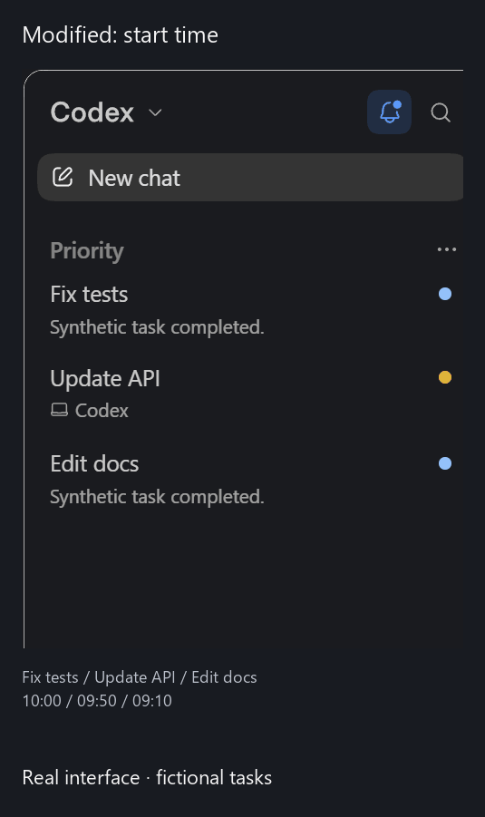

# Codex Desktop Workflow

The public installation defaults to English, including the persistent update notices. Existing language preferences and user content are preserved.

**See which Codex chat is waiting for your answer while you work on several chats at once.**

[](https://github.com/catterhu1207-ux/codex-desktop-workflow/actions/workflows/tests.yml)
[](https://github.com/catterhu1207-ux/codex-desktop-workflow/releases/latest)
[](LICENSE)

Windows x64 · Unofficial community tool · Builds an independent app from your official package

[中文说明](README.zh-CN.md)

[Project page](https://catterhu1207-ux.github.io/codex-desktop-workflow/) · [Report a problem](https://github.com/catterhu1207-ux/codex-desktop-workflow/issues)

## What becomes easier to see?

Miss a notification while several chats are running? The workflow keeps pending requests and plan states in the sidebar, with readable names for remote projects.

| Situation | Indicator or behavior |
|---|---|
| A question, option picker or permission request needs your input | 🟠 **Orange: answer or approval needed**, ahead of the spinner and other indicator colors |
| A completed plan is waiting to be implemented | 🟡 **Yellow: plan pending implementation**, including when the chat is pinned |
| A chat is pinned for attention | 🔴 **Red: pinned attention** |
| A chat has ordinary unread content | 🔵 **Blue: ordinary unread** |
| SSH projects show opaque IDs | Readable sidebar, search and Work picker labels; connection and task routing identities preserved |
| Parallel chats use different models | Existing valid model and reasoning settings preserved per chat; global defaults used for new chats |

Opening or reading a chat keeps its pending requests. Answering, approving, rejecting or cancelling recalculates the indicator. Orange remains while other requests still need attention.



*The demo shows lists, plan states and remote projects using fictional tasks. Orange is explained in the legend above.*

For Desktop 26.1016.8622.0, automatic lists sort by most recent chat activity first. Opening an older chat does not move it ahead after a restart. Manual order and pinned groups remain available. Older profiles retain their own documented contracts.

## Check compatibility first

**v0.3.13 targets official package 26.1016.8622.0. It retains the four browser-isolated source launches recorded for v0.3.12 and the same application bytes. See the [release page](https://github.com/catterhu1207-ux/codex-desktop-workflow/releases) for installer validation and available downloads.**

| Your environment | Installation status |
|---|---|
| Windows x64 with official package `26.1016.8622.0` | Official backend by default |
| Official package `26.1016.8120.0` | Retained with its v0.3.10 profile and build identity |
| Official package `26.1016.6573.0` | Retained with its v0.3.9 profile and build identity |
| Official package `26.1007.9446.0` | Retained with its qualified v0.3.8 profile |
| Official package `26.928.4866.0` | Supported by v0.3.5 and retained in the new source |
| Official package `26.924.2738.0` or `26.924.1866.0` | Supported |
| An older official package | See the [release compatibility matrix](https://github.com/catterhu1207-ux/codex-desktop-workflow/blob/main/COMPATIBILITY.md) |
| Any other package, including newer official versions | Unsupported by this release; wait for a matching release or [request an adaptation](https://github.com/catterhu1207-ux/codex-desktop-workflow/issues) |

Find your version in Codex's version information or Windows Installed apps. Installation checks the signature and complete file identity as well as the version. Development and local adaptation results are tracked separately from published installers.

## Three things to know before installing

1. **Your official app stays in place.** The workflow creates an independent app copy.
2. **Chat data is independent.** Continuing existing chats requires explicit data copying and signing in again. The two apps then keep separate data, without automatic synchronization.
3. **Installation includes checks.** Have Python 3.11 or later and Node.js 22 or later (tested with Node.js 24.18) and available disk space. Allow copying and isolated startup checks to finish. Compiler tools are needed only when you choose the optional compatibility-backend mode; its first complete source build can take hours.

## Install and start using it

### With a supported official app already installed

Run in PowerShell:

```powershell
irm https://github.com/catterhu1207-ux/codex-desktop-workflow/releases/latest/download/install.ps1 | iex
```

The official backend is the default. The installer discovers and verifies your official package, then creates the independent copy. Normal installation for `26.1016.8622.0` includes two isolated launches, each observed for at least 60 seconds of effective awake time. Startup, copying and validation add to that time. The empty-home check verifies the sign-in screen; no login is copied. The populated check uses 400 synthetic chats.

### With a complete official package that is not installed

Download `install.ps1` from the [release page](https://github.com/catterhu1207-ux/codex-desktop-workflow/releases/latest) and provide your supported complete x64 MSIX:

```powershell
.\install.ps1 -Source "D:\Downloads\ChatGPT-x64.msix"
```

This independently extracts and builds the copy without a Store installation. The package's internal version must still be supported.

Sign in inside the independent app after installation. To continue existing chats, follow [the data import instructions](docs/DEVELOPMENT.md#import-your-own-task-copy). Unsent blank pages and chats with accepted messages have different persistence behavior; see the [FAQ](docs/FAQ.md).

## Try it and tell us what happened

Useful feedback includes how many chats you handle, which states you tend to miss, and where installation gets stuck. Include your **Windows version, official package version, release version and error message**. Fictional tasks work well for reproducing a problem.

Use [Issues](https://github.com/catterhu1207-ux/codex-desktop-workflow/issues); keep accounts, tokens and real chat content on your machine.

## Further reading

- [FAQ](docs/FAQ.md): sign-in, data, official updates and verification time
- [Troubleshooting](docs/TROUBLESHOOTING.md): installation failure checks
- [Development and advanced use](docs/DEVELOPMENT.md): source builds, optional compatibility backend, data import and run management
- [Acceptance](ACCEPTANCE.md): published installation and runtime results
- [Maintenance skill](docs/maintenance/SKILL.md): adaptation and continuation workflow
- [Distribution status](docs/maintenance/2026-10-lessons.md): repository updates and installable releases

This project is unaffiliated with OpenAI. Release assets contain tools, dependencies and documentation; you supply the official application binaries.

## Update indicators in v0.3.13

The sidebar distinguishes an announced update, a verified downloadable package, and a qualified adaptation ready for a later launch with three different icons. The package's internal version determines whether the complete download has changed. Update checks run without a terminal window. Native unanswered questions and approvals keep their orange indicator even while the chat continues working.

For adapter maintenance, see the [maintenance skill](docs/maintenance/SKILL.md) and [first-send and monitor repair lessons](docs/maintenance/firstsend-and-monitor.md).
