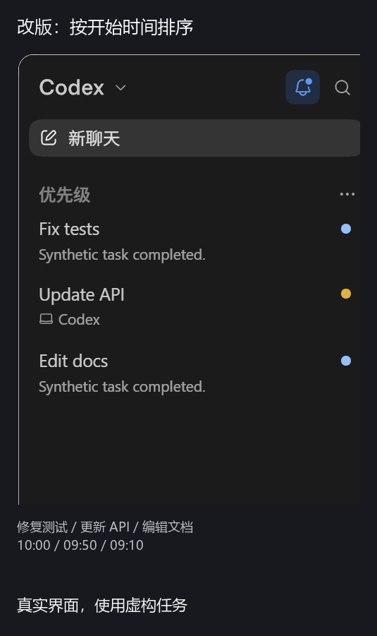

# Codex Desktop Workflow

**同时处理多个 Codex 聊天时，从侧栏看见哪个正在等你回答。**

[](https://github.com/catterhu1207-ux/codex-desktop-workflow/actions/workflows/tests.yml)
[](https://github.com/catterhu1207-ux/codex-desktop-workflow/releases/latest)
[](LICENSE)

Windows x64 · 非官方社区工具 · 从你提供的官方包生成独立应用

[English README](README.md) · [项目主页](https://catterhu1207-ux.github.io/codex-desktop-workflow/) · [反馈问题](https://github.com/catterhu1207-ux/codex-desktop-workflow/issues)

## 它帮你看清什么？

开着几个聊天工作，错过弹窗后还要逐个点开检查？本项目把待处理请求和计划状态留在侧栏，并让远程项目名称更容易辨认。

| 你遇到的情况 | 改版中的表现 |
|---|---|
| 有问题、选项或权限请求需要处理 | 🟠 **橙色圆点：待回答或批准**；有未处理请求时优先于转圈和其他提示色 |
| 计划写好了，等待你要求实施 | 🟡 **黄色圆点：计划待实施**；同时置顶仍显示黄色 |
| 想持续关注某个聊天 | 🔴 **红色：置顶关注** |
| 聊天有普通未读内容 | 🔵 **蓝色：普通未读** |
| SSH 项目显示难辨认的内部 ID | 侧栏、搜索和 Work 选择器显示可读名称，连接与任务路由身份保持不变 |
| 并行聊天使用不同模型 | 保留各聊天有效的模型与推理设置，全局默认用于新聊天 |

打开或阅读聊天会保留未处理请求；回答、批准、拒绝或取消后，状态重新计算。多个请求尚未全部处理时，橙色继续显示。



*上图展示列表、计划状态与远程项目，使用虚构任务；橙色含义见上方图例。*

针对 26.1021.3705.0，自动列表按最近聊天活动时间倒序排列；只打开旧聊天，重启后不会将它提前，保留手动顺序和置顶分组。较早版本继续使用各自已记录的排序规则。

## 先看你的版本能否安装

**v0.3.15 适配官方包 26.1021.3705.0，保留既有功能和旧版配置。官方后端为默认选项，兼容后端可选择从固定公开源码编译。下载见[发行页](https://github.com/catterhu1207-ux/codex-desktop-workflow/releases)。**

| 你的环境 | 安装条件 |
|---|---|
| Windows x64 + 官方包 `26.1021.3705.0` | 支持，默认使用官方后端 |
| 官方包 `26.1016.8622.0` | 保留独立配置和构建身份 |
| 官方包 `26.1016.8120.0` | 保留 v0.3.10 配置及原构建身份 |
| 官方包 `26.1016.6573.0` | 保留 v0.3.9 配置及原构建身份 |
| 官方包 `26.1007.9446.0` | 保留 v0.3.8 已验收的独立配置 |
| 官方包 `26.928.4866.0` | v0.3.5 已支持，新版源码保留兼容 |
| 官方包 `26.924.2738.0`、`26.924.1866.0` | 支持 |
| 较早官方包 | 查看[发行版支持矩阵](https://github.com/catterhu1207-ux/codex-desktop-workflow/blob/main/COMPATIBILITY.md) |
| 其他包号，包括较新的官方包 | 当前发行不支持；请等待匹配的发行版或提交[适配请求](https://github.com/catterhu1207-ux/codex-desktop-workflow/issues) |

可在 Codex 的版本信息或 Windows“已安装的应用”中查看版本。除了版本号，安装器还会核验签名和完整文件身份。开发分支及本机适配的结果与已发布安装包分别记录。


本版为超大本地聊天加入后台保护：历史文件超过 1 GiB 时，跳过可选的后台预测和临时分析，避免为这些操作复制整段历史。正常打开、继续聊天及已保存的任务设置保持可用。

## 安装前了解这三件事

1. **官方应用保留。** 改版生成独立应用副本，不覆盖官方安装。
2. **聊天数据独立。** 要继续已有聊天，需要显式复制任务数据，并在改版内重新登录。之后两边的数据各自保存，不自动同步。
3. **安装包含检查。** 准备 Python 3.11 以上、Node.js 22 以上（本次使用 24.18 验证）及可用磁盘空间。安装器会生成副本并运行隔离启动检查，请等待完成；兼容后端的编译工具仅在主动选择该模式时需要；首次完整源码编译可能耗时数小时。

## 安装与开始使用

### 已安装受支持的官方包

在 PowerShell 运行：

```powershell
irm https://github.com/catterhu1207-ux/codex-desktop-workflow/releases/latest/download/install.ps1 | iex
```

默认使用官方后端。安装器会自动查找你的官方包并核验来源，再生成独立副本。针对 `26.1021.3705.0`，正常安装包含两轮隔离启动检查；每轮至少观察 60 秒有效运行时间。启动、复制和校验耗时另计。空数据检查核对登录界面，不复制登录信息；模拟任务检查使用 400 条虚构聊天。

### 只有官方完整安装包，尚未安装

从[发行页](https://github.com/catterhu1207-ux/codex-desktop-workflow/releases/latest)下载 `install.ps1`，将受支持的完整 x64 MSIX 路径交给它：

```powershell
.\install.ps1 -Source "D:\Downloads\ChatGPT-x64.msix"
```

此方式独立解包并构建，不执行商店安装。安装包内版本仍须符合上面的支持范围。

安装完成后，在独立应用内登录。继续旧聊天的步骤见[聊天数据导入说明](docs/DEVELOPMENT.zh-CN.md#导入自己的任务副本)。没有首次发送的空白页与已经发送过消息的聊天分别处理，详情见 [FAQ](docs/FAQ.zh-CN.md)。

## 想试用或遇到问题？

欢迎反馈：你同时处理多少个聊天、哪种状态最容易错过、卡在安装的哪一步。报告问题时请附上 **Windows 版本、官方包版本、使用的发行版和错误信息**，任务内容可以用虚构例子替代。

请从[问题列表](https://github.com/catterhu1207-ux/codex-desktop-workflow/issues)提交，账号、令牌和真实聊天资料留在本机。

## 进一步阅读

- [FAQ](docs/FAQ.zh-CN.md)：登录、数据、官方更新与验证耗时
- [故障排查](docs/TROUBLESHOOTING.md)：安装失败后的检查入口
- [开发与高级用法](docs/DEVELOPMENT.zh-CN.md)：源码构建、可选兼容后端、数据导入和运行管理
- [验收记录](ACCEPTANCE.md)：已发布版本的独立安装和运行结果
- [维护技能](docs/maintenance/SKILL.md)：适配与续办流程
- [发行状态](docs/maintenance/2026-10-lessons.md)：仓库更新与可安装发行分别列示

本项目与 OpenAI 无隶属关系。发行资产包含工具、依赖与文档，官方应用二进制由用户自行提供。

## v0.3.15 的更新提示

侧栏用三个不同图标区分“官方已公布新版”“已核对新原包可下载”和“适配已就绪，等待下次启动”。下载包是否已更换，以包内版本核验为准。检查更新时隐藏终端窗口。原生中间提问和批准请求尚未处理时，即使聊天仍在工作，也持续显示橙色提示。

适配维护请参阅[维护技能](docs/maintenance/SKILL.md)及[首条消息与运行监控修复经验](docs/maintenance/firstsend-and-monitor.md)。
